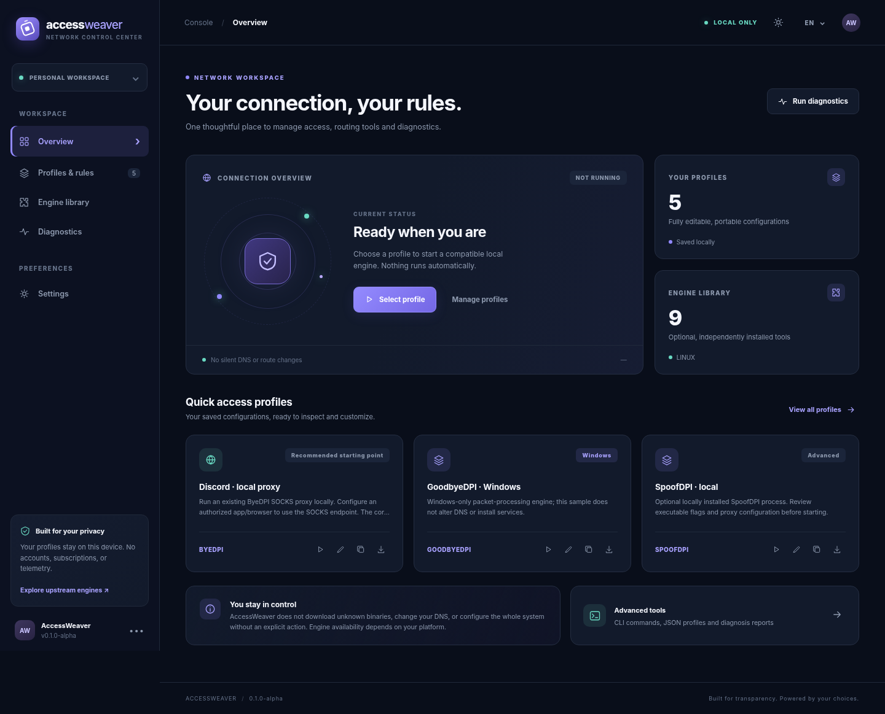

<div align="center">

# AccessWeaver

**Your connection, your rules.**

A local workspace for editable network profiles, external DPI/proxy engines and connection diagnostics.

**[English](README.md)** · **[Türkçe](README.tr.md)** · [Quick start](#quick-start) · [Engine guide](docs/ENGINES.md) · [Roadmap](docs/ROADMAP.md)

  

</div>



AccessWeaver brings profiles, domain rules, command previews and diagnostics into an English/Turkish/Russian/Spanish dashboard. The interface is bundled with a small Go application: no account, Node.js installation or remote application service is needed to run it.

Inspired by the workflow of SplitWire-Turkey, independently implemented. AccessWeaver is not affiliated with that project or the engine authors.

> [!IMPORTANT]
> **This is an alpha.** Windows installation, application routing, DNS and repair workflows are experimental. See [Windows workflows](docs/WINDOWS_WORKFLOWS.md) and [verification status](docs/SPLITWIRE_IMPLEMENTATION.md). Full SplitWire-Turkey behavioral parity is not yet certified. A running process does not prove that traffic is using it. Native mobile VPN clients and reliable automatic failover remain outside the implemented scope.

## What you can do

- Create, edit, duplicate, import and export portable JSON profiles.
- Use the guided editor or change the full JSON, including executable paths, argument arrays, external configuration paths and optional SHA-256 pins.
- Apply include/exclude domains through compatible adapters; unsupported routing rules block launch with an explanation.
- Review a launch plan and manage one foreground engine process at a time.
- Run direct or explicit SOCKS5/HTTP CONNECT TCP/TLS diagnostics, plus bounded direct/SOCKS5 UDP/STUN checks.
- Review and apply Windows component installation, services, app routing, hostlists, DNS, application repair and recovery through **Installation & repair**.
- Work in English, Turkish, Russian or Spanish, with dark/light themes and a responsive interface.
- Keep profile data on your device. AccessWeaver itself has no telemetry, ads, subscription or cloud sync; external engines have their own policies.

## Quick start

### Download a build

Open [Releases](https://github.com/Yunushan/accessweaver/releases), choose the archive for your OS and architecture, and extract it. Windows uses `.zip`; Linux, macOS and BSD use `.tar.gz`.

- **Windows:** double-click `accessweaver.exe`, or run it in PowerShell.
- **Linux, macOS and BSD:** run `./accessweaver` from the extracted folder.

The browser dashboard opens automatically; keep the console process running. **Go and Node.js are not needed for a downloaded build.** These are unsigned alpha binaries: download only from the project release and compare its checksum with `SHA256SUMS.txt`. See [checksum verification](docs/TESTING.md#release-packaging). Third-party engines are installed separately.

### Build from source

Install a current supported [Go release](https://go.dev/dl/) (the source requires Go 1.26 or later), then:

```bash
git clone https://github.com/Yunushan/accessweaver.git
cd accessweaver
go run ./cmd/accessweaver ui
```

Run the dashboard as your normal desktop user. The command prints its `http://127.0.0.1:...` listener and a private launch-file URL, which it opens in your browser when possible. Use that launch file to connect; the listener alone does not authorize API access. Keep the terminal running; press **Ctrl+C** to shut down the local application and its managed child process. No engine starts automatically.

To build a local executable:

| Platform | Build and start |
|---|---|
| Linux, macOS, FreeBSD, OpenBSD with Bash | `bash scripts/setup.sh --run` |
| Windows PowerShell | `./scripts/setup.ps1 -Run` |
| Any supported Go target, manual build | `go build -o accessweaver ./cmd/accessweaver` then `./accessweaver ui` (use `.exe` on Windows) |

The setup scripts compile into `bin/`; they do not install third-party engines or change system settings. If PowerShell blocks local scripts, use the manual `go build -o accessweaver.exe ./cmd/accessweaver` command. Node.js is only needed for the development JavaScript checks and tests.

### First profile

1. Open **Profiles & rules** and duplicate a starter profile, or create your own.
2. Install the chosen engine from its [official upstream](docs/ENGINES.md). Set its executable path and review its version-specific arguments.
3. Add domains only when the adapter supports them. Set an external configuration file when required.
4. Inspect the command preview and resolve readiness errors. Start explicitly when ready.
5. Configure the application proxy or OS interception separately, following the engine guide. Verify the intended traffic path through that application.

For a ByeDPI local proxy, the starter listener is `127.0.0.1:1080`. Applications must use that SOCKS endpoint before traffic will pass through it. For packet engines, required drivers and firewall rules remain your responsibility. Diagnostics default to the normal network stack. Select SOCKS5 and its endpoint explicitly to test that proxy; there is no direct fallback. See [diagnostic scope and examples](docs/DIAGNOSTICS.md).

### CLI

```bash
accessweaver engines                  # Catalog and upstream sources
accessweaver profiles                 # Saved profiles
accessweaver show discord-proxy       # Inspect a profile as JSON
accessweaver preview discord-proxy    # Read-only command and readiness plan
accessweaver validate my-profile.json # Validate the profile schema
accessweaver import my-profile.json   # Save it locally (same ID replaces a profile)
accessweaver doctor example.com       # Direct DNS/TCP/TLS diagnostics
accessweaver run discord-proxy        # Start an installed engine in the foreground
```

Use `./bin/accessweaver` or `.\bin\accessweaver.exe` if the binary is not on `PATH`. See [profile format and storage](docs/PROFILES.md) for a complete example and the distinction between schema validity and launch readiness.

## Engines and routing

| Engine | Adapter targets | Managed domain rules | Current boundary |
|---|---|---|---|
| [ByeDPI](https://github.com/hufrea/byedpi) | Windows, Linux, macOS, FreeBSD, OpenBSD | Include + exclude | Local SOCKS; macOS/BSD need a compatible build; app proxy settings separate |
| [Zapret2](https://github.com/bol-van/zapret2) | Windows, Linux, FreeBSD, OpenBSD | Include + exclude | Needs upstream packet interception setup and a tested strategy |
| [Zapret](https://github.com/bol-van/zapret) | Windows, Linux, FreeBSD, OpenBSD; limited macOS | Include + exclude | Legacy upstream; macOS uses the `tpws` proxy path |
| [GoodbyeDPI](https://github.com/ValdikSS/GoodbyeDPI) | Windows | Include only | Requires compatible WinDivert and privileges |
| [WireSock SDK](https://wiresock.net/wiresock-sdk) | Windows | External config only | Foreground SDK client; vendor terms and VPN configuration apply |
| [SpoofDPI](https://github.com/xvzc/spoofdpi) | Windows, Linux, macOS | External arguments only | Local proxy; review upstream version and listen settings |
| [sing-box](https://github.com/SagerNet/sing-box) / [Xray-core](https://github.com/XTLS/Xray-core) | Selected desktop/BSD targets | External config only | Existing configuration and any required endpoint are external |
| [WireGuard](https://www.wireguard.com/) | Reference catalog entry | External configuration | Native tunnel lifecycle is not managed in this alpha |

These are adapter targets, **not a real-device certification matrix**. Guided WireSock application rules generate a private configuration copy; other foreground adapters reject populated application rules. Domain exclusions affect the selected engine's processing and do not constitute a system-wide firewall or per-app split tunnel. See [engine behavior and setup](docs/ENGINES.md).

## Platform status

| Platform | Current deliverable | Remaining platform work |
|---|---|---|
| Windows | Go CLI + local browser dashboard; amd64/arm64 build targets | Signed installer, service/driver management, device testing |
| Linux | Go CLI + local browser dashboard; amd64/arm64 | Distribution testing, privilege separation, managed firewall hooks |
| macOS | Go CLI + local browser dashboard; Intel/Apple silicon | Signed/notarized packaging, native network integration |
| FreeBSD / OpenBSD | Go CLI + browser dashboard; amd64/arm64 | Native execution and packet-hook integration testing |
| Android | Responsive offline profile editor only | Native app, `VpnService`, device tests |
| iOS / iPadOS | Responsive offline profile editor only | Native app, Packet Tunnel Provider, signing and device tests |

Opening the static UI on a phone does not provide VPN capability. Offline browser profiles live in browser storage and must be exported/imported to move them into the desktop application. See [platform coverage](docs/PLATFORMS.md).

## Development and releases

```bash
go vet ./...
go test ./... -count=1
go test -race ./...
node --check web/app.js
node --test web/app.test.cjs
bash scripts/build-all.sh
bash scripts/package-release.sh preview
```

Cross-build and packaging scripts require Go, Bash and Python 3.

Saved profiles can be exported as authenticated, password-encrypted archives and restored into a new data directory through the [backup CLI](docs/BACKUP_RESTORE.md). External files, machine policy and OS state require separate recovery.

Windows, Linux and macOS have partial signed administrator-policy enforcement; [managed configuration](docs/MANAGED_CONFIGURATION.md) documents its protected source, platform-specific install/update/rotation commands, current limits and unfinished recovery/qualification.

The [audit commands](docs/AUDIT_EVENTS.md) verify segments against independently retained checkpoints and support explicit, revision-checked profile imports on Linux and Windows amd64/arm64 with durable intent/outcome records, consented read-only JSONL export and an explicit profile-editing desktop that requires audit records for saves/deletes. Signed managed policy can require recorded profile changes. Explicit Linux policy install/update/rotation/recovery commands also record intent and conservative native outcomes. A separate [recorded export](docs/RECORDED_AUDIT_EXPORT.md) records access to a current-stream snapshot while preserving the read-only archive command. An explicit [recorded foreground engine run](docs/RECORDED_ENGINE_RUN.md) records launch acceptance and actual termination. Broader controller/admin audit coverage, other desktop storage and collector integration remain unfinished.

CI is configured to run unit tests on Linux, Windows and macOS, a Linux race check, and ten cross-build targets. A workflow configuration is not evidence that a run passed: see [Actions](https://github.com/Yunushan/accessweaver/actions) for results. BSD cross-compilation does not execute tests on BSD. [Real browser acceptance](docs/BROWSER_ACCEPTANCE.md) documents its pinned non-root environment and qualification limits.

Release archives contain the standalone application, documentation and license notices. They exclude third-party engines and are **unsigned alpha builds**. Checksums detect file changes; they are not publisher signatures. Hosted release builds additionally provide [signed build provenance](docs/RELEASE_PROVENANCE.md), verified against a separately trusted source commit/ref; Windows/macOS publisher signing remains unfinished. [Testing](docs/TESTING.md) · [Contributing](CONTRIBUTING.md) · [Architecture](docs/ARCHITECTURE.md) · [Release process](GITHUB_SETUP.md)

## License and security

AccessWeaver's original source is [0BSD](LICENSE). External engines retain separate licenses and trademarks; WireSock also has product-specific commercial terms. [Third-party notices](THIRD_PARTY.md) explain the boundary.

The local API uses loopback binding, host/origin checks and a per-process request token. Engine invocation uses argument arrays. These controls do not sandbox an external program or make AccessWeaver an audited security product. See [SECURITY.md](SECURITY.md) before privileged deployment.
