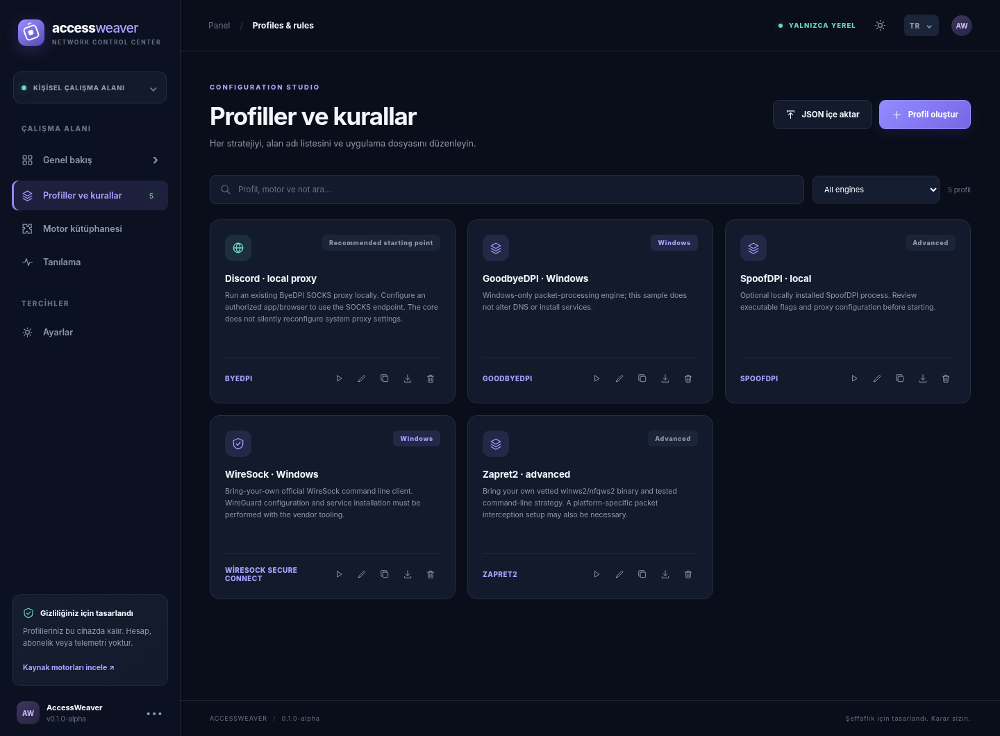

<div align="center">

# AccessWeaver

**Bağlantınız, kurallarınız.**

Düzenlenebilir ağ profilleri, harici DPI/proxy motorları ve bağlantı tanılaması için yerel çalışma alanı.

**[English](README.md)** · **[Türkçe](README.tr.md)** · [Motor rehberi](docs/ENGINES.md) · [Yol haritası](docs/ROADMAP.md)

  

</div>



AccessWeaver; profilleri, alan adı kurallarını, çalıştırma ön izlemesini ve tanılamayı İngilizce/Türkçe bir panelde birleştirir. Arayüz Go uygulamasının içine gömülüdür; çalıştırmak için hesap, Node.js kurulumu veya uzak uygulama sunucusu gerekmez.

SplitWire-Turkey'in iş akışından esinlenen bağımsız bir uygulamadır. Bu projeyle veya motor geliştiricileriyle resmi bağlantısı yoktur.

> [!IMPORTANT]
> **Bu bir alpha sürümüdür.** Windows kurulum, uygulama yönlendirme, DNS ve onarım iş akışları deneyseldir. [Windows rehberine](docs/WINDOWS_WORKFLOWS.md) ve [doğrulama durumuna](docs/SPLITWIRE_IMPLEMENTATION.md) bakın. Tam SplitWire-Turkey davranış eşitliği henüz doğrulanmamıştır. Bir işlemin çalışması, trafiğin o işlemden geçtiğini kanıtlamaz. Yerel mobil VPN istemcileri ve güvenilir otomatik geçiş uygulanmış değildir. Arayüz İngilizce, Türkçe, Rusça ve İspanyolca seçenekleri sunar.

## Yapabilecekleriniz

- Taşınabilir JSON profilleri oluşturun, düzenleyin, çoğaltın, içe ve dışa aktarın.
- Kolay düzenleyiciden veya tam JSON üzerinden program yolunu, parametreleri, harici yapılandırma yolunu ve isteğe bağlı SHA-256 özetini değiştirin.
- Uyumlu adaptörlerde dahil/hariç alan adlarını kullanın; desteklenmeyen kurallar açıklayıcı bir hatayla başlatmayı engeller.
- Çalıştırma planını inceleyin ve aynı anda bir motor işlemini yönetin.
- DNS, TCP ve sertifikası doğrulanan TLS testlerini aşama süreleriyle görüntüleyin.
- İngilizce/Türkçe arayüzü, koyu/açık temayı ve farklı ekran boyutlarına uygun düzeni kullanın.
- Profilleri cihazınızda tutun. AccessWeaver'ın kendisinde telemetri, reklam, abonelik veya bulut eşitleme yoktur; harici motorların kendi politikaları geçerlidir.

## Hızlı başlangıç

### Hazır sürümü indirin

[Releases](https://github.com/Yunushan/accessweaver/releases) sayfasından işletim sistemi ve mimarinize uygun arşivi seçin ve çıkartın. Windows için `.zip`; Linux, macOS ve BSD için `.tar.gz` kullanılır.

- **Windows:** `accessweaver.exe` dosyasına çift tıklayın veya PowerShell'den çalıştırın.
- **Linux, macOS ve BSD:** çıkartılan klasörde `./accessweaver` çalıştırın.

Tarayıcı paneli otomatik açılır; konsol işlemini açık bırakın. **Hazır sürüm için Go veya Node.js gerekmez.** Paketler imzasız alpha derlemeleridir; yalnızca projenin sürüm sayfasından indirin ve dosya özetini `SHA256SUMS.txt` ile karşılaştırın. [Doğrulama rehberi](docs/TESTING.md#release-packaging). Harici motorlar ayrıca kurulur.

### Kaynak koddan derleyin

Güncel ve desteklenen bir [Go sürümü](https://go.dev/dl/) kurun (kaynak kod en az Go 1.24 gerektirir):

```bash
git clone https://github.com/Yunushan/accessweaver.git
cd accessweaver
go run ./cmd/accessweaver ui
```

Komut `http://127.0.0.1:...` adresini yazar ve mümkünse tarayıcıyı açar. Terminali açık bırakın; **Ctrl+C** yerel uygulamayı ve yönettiği alt işlemi kapatır. Hiçbir motor kendiliğinden başlamaz.

| Platform | Derleme ve başlatma |
|---|---|
| Bash bulunan Linux, macOS, FreeBSD, OpenBSD | `bash scripts/setup.sh --run` |
| Windows PowerShell | `./scripts/setup.ps1 -Run` |
| Elle derleme | `go build -o accessweaver ./cmd/accessweaver` ardından `./accessweaver ui` (Windows'ta `.exe`) |

Betikler uygulamayı `bin/` içine derler; üçüncü taraf motor kurmaz veya sistem ayarlarını değiştirmez. PowerShell yerel betikleri engellerse `go build -o accessweaver.exe ./cmd/accessweaver` komutunu kullanın. Node.js yalnızca geliştirme sırasında JavaScript kontrolleri ve testleri için gerekir.

### İlk profil

1. **Profiller ve kurallar** sayfasında bir başlangıç profilini çoğaltın veya profil oluşturun.
2. Motoru [resmi kaynağından](docs/ENGINES.md) kurun. Program yolunu belirtin ve kullandığınız sürümün parametrelerini inceleyin.
3. Yalnızca adaptörün desteklediği alan adı kurallarını ekleyin. Gerekiyorsa harici yapılandırma dosyasını seçin.
4. Çalıştırma ön izlemesini inceleyin, hazırlık hatalarını çözün ve hazır olduğunuzda açıkça başlatın.
5. Uygulama proxy ayarını veya işletim sistemi paket işleme kurulumunu motor rehberine göre ayrıca yapın. Trafiğin istediğiniz yoldan geçtiğini uygulamanın içinden doğrulayın.

ByeDPI başlangıç profili `127.0.0.1:1080` üzerinde dinler. Trafiğin buradan geçmesi için uygulamanın SOCKS ayarı bu adrese yönlendirilmelidir. Paket motorlarının sürücü/firewall kurulumları ayrıca yapılır. Yerleşik tanılama, bilgisayarın normal ağ yolunu kullanır; seçili SOCKS proxy'sini özel olarak test etmez.

### Komut satırı

```bash
accessweaver engines                  # Katalog ve resmi kaynaklar
accessweaver profiles                 # Kayıtlı profiller
accessweaver show discord-proxy       # Profil JSON'unu göster
accessweaver preview discord-proxy    # Komut ve hazırlık planını göster
accessweaver validate my-profile.json # Profil şemasını doğrula
accessweaver import my-profile.json   # Kaydet; aynı kimlik varsa üzerine yazar
accessweaver doctor example.com       # Doğrudan DNS/TCP/TLS testi
accessweaver run discord-proxy        # Kurulu motoru ön planda başlat
```

Program `PATH` üzerinde değilse `./bin/accessweaver` veya `.\bin\accessweaver.exe` kullanın. [Profil biçimi](docs/PROFILES.md), şema geçerliliği ile çalıştırmaya hazır olma arasındaki farkı açıklar.

## Motorlar ve kurallar

| Motor | Adaptör hedefleri | Yönetilen alan adı kuralları | Sınır |
|---|---|---|---|
| ByeDPI | Windows, Linux, macOS, FreeBSD, OpenBSD | Dahil + hariç | Yerel SOCKS; macOS/BSD için uyumlu derleme gerekir |
| Zapret2 | Windows, Linux, FreeBSD, OpenBSD | Dahil + hariç | Paket yakalama kurulumu ve doğrulanmış strateji gerekir |
| Zapret | Windows, Linux, FreeBSD, OpenBSD; sınırlı macOS | Dahil + hariç | Eski motor; macOS'ta `tpws` proxy yolu |
| GoodbyeDPI | Windows | Yalnızca dahil | Uyumlu WinDivert ve yetki gerekir |
| WireSock SDK | Windows | Harici yapılandırma | Ön planda SDK istemcisi; sağlayıcı şartları geçerlidir |
| SpoofDPI | Windows, Linux, macOS | Harici parametreler | Yerel proxy; sürüm ve dinleme ayarını inceleyin |
| sing-box / Xray-core | Belirli masaüstü/BSD hedefleri | Harici yapılandırma | Geçerli yapılandırma ve gerekiyorsa uç nokta gerekir |
| WireGuard | Bilgi amaçlı katalog kaydı | Harici yapılandırma | Bu alpha sürümünde tünel yaşam döngüsü yönetilmez |

Bunlar adaptör hedefleridir; **gerçek cihaz sertifikasyonu değildir**. WireSock uygulama kuralları özel bir yapılandırma kopyasına yazılır; diğer ön plan adaptörlerinde dolu uygulama kuralları başlatmayı engeller. Alan adı istisnaları motorun işlemesini sınırlar; sistem genelinde firewall veya uygulama bazlı split tunnel sağlamaz. [Motor rehberi](docs/ENGINES.md).

## Platform durumu

| Platform | Mevcut ürün | Kalan işler |
|---|---|---|
| Windows | CLI + yerel panel; amd64/arm64 derleme hedefi | İmzalı kurulum, servis/sürücü yönetimi, cihaz testleri |
| Linux | CLI + yerel panel; amd64/arm64 | Dağıtım testleri, yetki ayrımı, firewall yönetimi |
| macOS | CLI + yerel panel; Intel/Apple silicon | İmzalı/notarize paket, yerel ağ entegrasyonu |
| FreeBSD / OpenBSD | CLI + panel; amd64/arm64 | Yerel çalıştırma ve paket işleme testleri |
| Android | Yalnızca çevrimdışı profil düzenleyici | Yerel uygulama, `VpnService`, cihaz testleri |
| iOS / iPadOS | Yalnızca çevrimdışı profil düzenleyici | Yerel uygulama, Packet Tunnel Provider, imzalama, cihaz testleri |

Telefonda statik arayüz açmak VPN özelliği sağlamaz. Çevrimdışı profiller tarayıcıda saklanır; masaüstüne taşımak için dışa/içe aktarma gerekir. [Platform ayrıntıları](docs/PLATFORMS.md).

## Geliştirme ve sürümler

```bash
go vet ./...
go test ./... -count=1
go test -race ./...
node --check web/app.js
node --test web/app.test.cjs
bash scripts/build-all.sh
bash scripts/package-release.sh preview
```

CI; Linux, Windows, macOS birim testleri, Linux race kontrolü ve on hedef için çapraz derleme yapacak şekilde yapılandırılmıştır. Sonuçlar [Actions](https://github.com/Yunushan/accessweaver/actions) sayfasından doğrulanmalıdır. BSD çapraz derlemesi BSD üzerinde çalıştırma testi değildir.

Sürüm arşivlerinde uygulama, belgeler ve lisans bildirimleri bulunur. Harici motorlar dahil değildir; paketler **imzasız alpha derlemeleridir**. Dosya özetleri değişiklikleri saptar, yayıncı imzası yerine geçmez. [Test rehberi](docs/TESTING.md) · [Katkı](CONTRIBUTING.md) · [Mimari](docs/ARCHITECTURE.md).

## Lisans ve güvenlik

Özgün AccessWeaver kodu [0BSD](LICENSE) lisanslıdır. Harici motorların ayrı lisansları ve marka hakları vardır; WireSock ürününe özgü ticari şartlar da geçerlidir. [Üçüncü taraf bildirimleri](THIRD_PARTY.md).

Yerel API, loopback adresi, sunucu/kaynak denetimi ve işleme özel istek anahtarı kullanır. Motorlar parametre dizileriyle başlatılır. Bunlar harici programı yalıtmaz veya AccessWeaver'ı denetlenmiş bir güvenlik ürünü yapmaz. [Güvenlik politikası](SECURITY.md).
