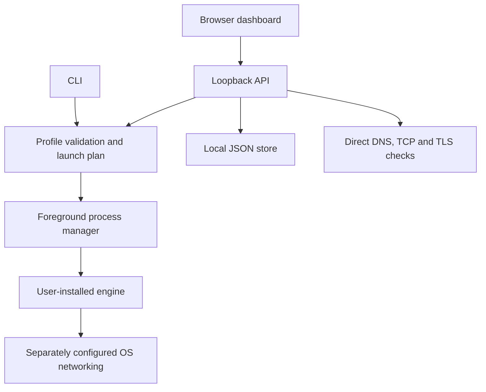

# Architecture

AccessWeaver is a single Go executable with embedded static HTML/CSS/JavaScript. The core uses the Go standard library. A browser UI and CLI share profile, engine and diagnostic modules.

## Boundaries

| Component | Responsibility | Does not establish |
|---|---|---|
| Static UI | Editing, four-language presentation, preview and explicit commands | Native mobile networking or privileged OS access |
| Loopback API | Local request validation and dispatch | Authentication against other processes running as the user |
| Profile store | Versioned JSON, validation, atomic replacement and OS-locked revision checks across cooperating local processes | Secret encryption or safe semantics for arbitrary engine arguments |
| Launch planner | Platform/executable checks, optional hash, configuration checks and supported rule translation | Trusted publisher identity, a valid engine strategy or working traffic interception |
| Process manager | One foreground child, bounded output, stop/shutdown | A service manager, installer or rollback of third-party OS changes |
| Diagnostics | Direct DNS resolution, TCP connect and certificate-verified TLS handshake | Selected SOCKS route, UDP/voice, QUIC, hostlist correctness or anonymity |

The control listener binds to `127.0.0.1` on an ephemeral port. Host and browser-origin checks protect the API from typical cross-origin/rebinding access, and every API request, including reads and bootstrap, needs a random per-process token delivered through the OS-private launcher. The dashboard refuses elevated/root execution; Windows machine changes require separately elevated CLI requests. The static UI uses same-origin assets and a restrictive content security policy. The API is a local implementation interface, not a supported remote administration protocol.

`POST /api/v1/preview` accepts a full profile and returns a read-only plan. A ready plan may still carry warnings. Starting a saved profile validates prerequisites again, creates generated hostlists and launches the executable directly with an argument array, without a shell. The child runs from its executable directory with the controller's privileges.

## Process and configuration ownership

Profiles belong to the AccessWeaver store. External configuration files, VPN credentials, Lua assets, drivers and OS networking belong to their respective tools and users. An export includes a `configPath` reference, not the referenced file. Shell-hook rejection for WireSock and adapter checks reduce particular hazards; they do not sandbox engine code or external configuration.

POSIX lifecycle uses a process group and bounded termination. Windows lifecycle currently terminates the foreground process; graceful console control, service ownership and network-state rollback need platform-specific implementation. Each configuration root has a controller lock for UI/foreground execution and CLI import, with a separate profile-operation lock. Windows administrative workflows use a machine-wide mutex; user application operations do not share that mutex. These controls do not form a universal singleton across all roots and modes.

Offline browser mode stores profiles in local storage. It shares the editor presentation, but has no core API and cannot provide engine process management or network diagnostics. Import/export is the explicit bridge to the desktop store.

## Next architectural work

Planned work includes a privilege-separated broker, engine provenance/version metadata, transactional OS changes and rollback, native tunnel lifecycle, and meaningful end-to-end traffic tests. Android needs a real app and VPN service; iOS needs a signed native tunnel extension. These are separate implementations, not capabilities conferred by the responsive web UI. See [ROADMAP.md](ROADMAP.md).

## Local process coordination

`.profiles.lock` serializes profile reads, mutations and initial seeding on a local data root. Windows uses an exclusive `LockFileEx` byte-range lock; Linux/macOS/BSD use `flock`. Acquisition waits at most five seconds before reporting a retryable busy condition. Lock files are persistent coordination objects, while OS handles own their lifetime: they are never unlinked on release. A handle/path identity check rejects a replaced lock path during acquisition. Manual writes, deletion of a live lock file and older binaries remain outside the protocol.

The CLI also holds `.controller.lock` throughout `ui`, `run` and `import`, before seeding, to prevent two foreground owners or a CLI import from racing an active controller. This root lock is distinct from profile-operation locks and the Windows machine-workflow mutex. Different roots and Windows system workflow jobs retain their existing ownership boundaries.

## Signed administrator documents

The `managed` CLI signs, verifies and prepares versioned Ed25519 policy envelopes. A separately elevated Windows CLI installs only absent policy using an independent key pin; updates retain the enrolled key and advance the authenticated revision floor inside a native registry transaction. Expired-policy metadata may be authenticated solely for renewal; runtime checks still reject expiry. Key rotation and damaged-state recovery remain unfinished. Windows reads the complete public key, revision floor and envelope from one protected 64-bit HKLM registry value. User data roots and environment variables cannot select that authority. Guards protect profile mutations, diagnostics, foreground launches and workflow requests/downloads, and reject unimplemented managed service-host authorization. Checks repeat at lock and execution boundaries; worker permissions travel with the exact retained in-memory request. Unmanaged behavior remains available when the protected key is absent. Non-Windows authority and several native provenance/service paths remain unfinished. [Managed configuration](MANAGED_CONFIGURATION.md) defines the protocol, current restrictions and remaining qualification.
