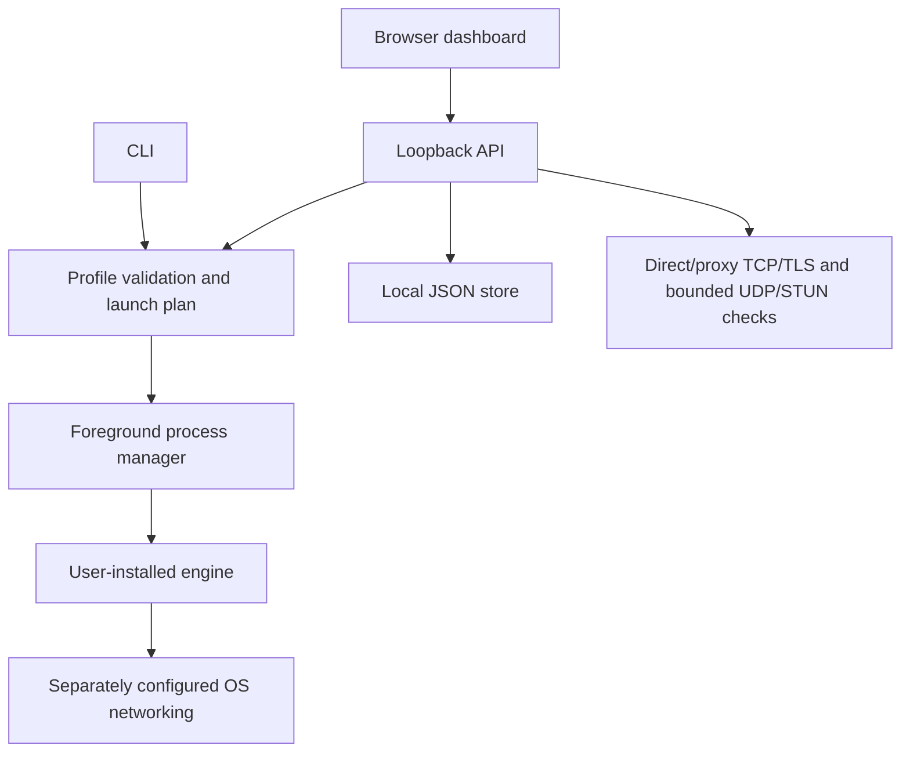

# Architecture

AccessWeaver is a single Go executable with embedded static HTML/CSS/JavaScript. A browser UI and CLI share profile, engine and diagnostic modules. The core uses the Go standard library plus the pinned `golang.org/x/sys` and `github.com/ebitengine/purego` modules for native OS interfaces. Optional fixtures and build/security tooling have separate module boundaries; see [SBOM scope](SBOM.md).

## Boundaries

| Component | Responsibility | Does not establish |
|---|---|---|
| Static UI | Editing, four-language presentation, preview and explicit commands | Native mobile networking or privileged OS access |
| Loopback API | Local request validation and dispatch | Authentication against other processes running as the user |
| Profile store | Versioned JSON, validation, atomic replacement and OS-locked revision checks across cooperating local processes | Secret encryption or safe semantics for arbitrary engine arguments |
| Launch planner | Platform/executable checks, optional hash, configuration checks and supported rule translation | Trusted publisher identity, a valid engine strategy or working traffic interception |
| Process manager | One foreground child, bounded output, stop/shutdown | A service manager, installer or rollback of third-party OS changes |
| Diagnostics | Direct resolution/TCP/TLS, explicitly selected SOCKS5 or HTTP CONNECT, and bounded direct/SOCKS5 UDP STUN probes | Ordinary application routing, OS resolver privacy, actual voice/QUIC operation, hostlist correctness or anonymity |

The control listener binds to `127.0.0.1` on an ephemeral port. Host and browser-origin checks protect the API from typical cross-origin/rebinding access, and every API request, including reads and bootstrap, needs a random per-process token delivered through the OS-private launcher. The dashboard refuses elevated/root execution; Windows machine changes require separately elevated CLI requests. The static UI uses same-origin assets and a restrictive content security policy. The API is a local implementation interface, not a supported remote administration protocol.

`POST /api/v1/preview` accepts a full profile and returns a read-only plan. A ready plan may still carry warnings. Starting a saved profile validates prerequisites again, creates generated hostlists and launches the executable directly with an argument array, without a shell. The child runs from its executable directory with the controller's privileges.

## Process and configuration ownership

Profiles belong to the AccessWeaver store. External configuration files, VPN credentials, Lua assets, drivers and OS networking belong to their respective tools and users. An export includes a `configPath` reference, not the referenced file. Shell-hook rejection for WireSock and adapter checks reduce particular hazards; they do not sandbox engine code or external configuration.

POSIX lifecycle uses a process group and bounded termination. Windows lifecycle currently terminates the foreground process; graceful console control, service ownership and network-state rollback need platform-specific implementation. Each configuration root has a controller lock for UI/foreground execution and CLI import, with a separate profile-operation lock. Windows administrative workflows use a machine-wide mutex; user application operations do not share that mutex. These controls do not form a universal singleton across all roots and modes.

The engine manager retains a separate copy-safe handle for each accepted launch. It publishes that launch's terminal reason, actual process-wait error and policy cause before closing its completion channel; later launches cannot replace the result. Cancelling a handle wait does not terminate the process. Initial and forced stop dispatches resolve before terminal classification without holding the status mutex over signal calls; failed signals cannot suppress an unexpected exit. Native process startup retains its existing status-lock/closing atomicity and native-I/O limitations. These lifecycle observations support future asynchronous audit producers; they do not connect engine/workflow actions to the synchronous recorder or complete the enterprise audit gate. See [engine ownership](ENGINES.md).

Offline browser mode stores profiles in local storage. It shares the editor presentation, but has no core API and cannot provide engine process management or network diagnostics. Import/export is the explicit bridge to the desktop store.

## Next architectural work

Planned work includes a privilege-separated broker, engine provenance/version metadata, transactional OS changes and rollback, native tunnel lifecycle, and meaningful end-to-end traffic tests. Android needs a real app and VPN service; iOS needs a signed native tunnel extension. These are separate implementations, not capabilities conferred by the responsive web UI. See [ROADMAP.md](ROADMAP.md).

## Local process coordination

`.profiles.lock` serializes profile reads, mutations and initial seeding on a local data root. Windows uses an exclusive `LockFileEx` byte-range lock; Linux/macOS/BSD use `flock`. Acquisition waits at most five seconds before reporting a retryable busy condition. Lock files are persistent coordination objects, while OS handles own their lifetime: they are never unlinked on release. A handle/path identity check rejects a replaced lock path during acquisition. Manual writes, deletion of a live lock file and older binaries remain outside the protocol.

The CLI also holds `.controller.lock` throughout `ui`, `run` and `import`, before seeding, to prevent two foreground owners or a CLI import from racing an active controller. This root lock is distinct from profile-operation locks and the Windows machine-workflow mutex. Different roots and Windows system workflow jobs retain their existing ownership boundaries.

## Signed administrator documents

The `managed` CLI signs, verifies and prepares versioned Ed25519 policy envelopes. Native authority is independent of user data roots and environment overrides: Windows reads a protected 64-bit HKLM registry value; Linux amd64/arm64 reads a root-owned installation/acceptance pair under `/etc/accessweaver`; macOS amd64/arm64 reads its root-owned pair under `/Library/Preferences/AccessWeaver`. BSD native machine authority remains unfinished.

Separately elevated CLI writers implement initial enrollment, monotonic update, planned key rotation and signed recovery. Windows uses native registry transactions. Linux and macOS use descriptor-relative checks, protected writer coordination and synced publication of paired state; macOS additionally requires qualified local APFS ownership/ACL semantics. Planned rotation binds old-key authorization to the exact prior state and a higher-revision policy signed by a different new key. Recovery requires its own authenticated prior-state and revision constraints. These implementations still require the documented deployment, storage and recovery qualification.

Guards protect profile mutations, diagnostics, foreground launches and workflow requests/downloads. Policy checks repeat at lock and execution boundaries; worker permissions travel with the retained in-memory request. Active operations retain policy identity/expiry and cancel their contexts when the one-second monitor detects a change, removal, enrollment, expiry or unreadable authority. This is not an instantaneous OS revocation primitive or proof that a vendor's external state has been undone. Managed service-host authorization, generated inputs and native-argument assets remain blocked where protected authorization/staging is unfinished. Managed foreground children receive a fixed native environment; unmanaged behavior remains available when native authority is absent.

[Managed configuration](MANAGED_CONFIGURATION.md) defines the protocol, source protection and remaining restrictions. [macOS acceptance](MACOS_MANAGED_POLICY.md) and [native acceptance](MACHINE_POLICY_ACCEPTANCE.md) distinguish source implementation, disposable tests and managed endpoint qualification.

The internal macOS deployment prototype uses a separate root-owned local-APFS authority under `/Library/Application Support/AccessWeaver`, with descriptor-relative no-follow access, a nonblocking lifecycle lock, exclusively reserved version slots and an atomic deployment-record directory exchange. The fixed parent must already satisfy the strict protection checks; the prototype never repairs global parent permissions. A prepared slot binds its device/inode, sealed manifest/core identities and the current generation. Activation copies and fully verifies a new independent bundle before publishing; removal publishes a tombstone, advances the generation and retains the high-water release, so earlier prepared or complete slots cannot reactivate it. A complete interrupted copy can be verified and activated on retry. Partial copies, abandoned slots and displaced records are retained for inspection, with bounded capacities (eight pending transactions, 64 slots, 128 prior/staged records); there is no automatic recursive cleanup or rollback from guessed receipt state. Publication reports whether the rename occurred even when subsequent durability work fails. Native fsync/full-sync calls and injected operation errors do not establish physical power-loss safety.

The transaction engine is exposed only through the separate root-only packaging tool. Ordinary builds have empty deployment seals and refuse deployment operations; the native packaging build must compile the expected version, manifest and core digests into the new helper. There are no caller path or environment overrides. Prepare alone may initialize the fixed authority. Activate reconciles exactly one matching pending slot or independently verifies an already-active matching copy; ambiguous/stale prepares refuse, and abandoning a prepare retains its files. Existing legacy apps/partial receipts require explicit migration rather than implicit replacement. Existing history with a missing versions directory refuses before initializer mutations. Experimental native deployment packages now carry the sealed helper as their preinstall/postinstall phases. Their incoming manifest and compiled payload graph live outside the app bundle, avoiding a signing-resource cycle. The actual Installer lifecycle covers clean install, upgrade, reinstall, downgrade refusal and selected damaged-state recovery. Retained-copy reclamation, explicit legacy migration, complete product uninstall, reboot/power-loss behavior, publisher signing/notarization and managed endpoint qualification remain unfinished. The `/Applications` read-only preflight remains a snapshot and cannot authorize privileged replacement.

The public desktop entry is a separately registered launcher, not the core deployment authority. A root-owned bounded registry under `/Library/Application Support/AccessWeaver Desktop` binds its complete app inventory; the `/Applications/AccessWeaver.app` self-description only filters candidates for full verification. Separate metadata and app component helpers inspect fixed paths, compiled role/record seals and native installation state without running installed product code as root. Registered public entries coexist with versioned core updates; unknown, changed or aliased entries and legacy receipts refuse replacement. These ordered components do not yet form a qualified single product distribution or an atomic transaction across Installer packages.

The ordinary-user launcher verifies the active independent core copy and passes the same shared runtime lease through exec to that core. The core validates and adopts the descriptor before serving; lifecycle writers require an exclusive lease. Incoming and retired controller copies refuse serving. Default LaunchServices launch, the kernel-reported active image and ordinary owner, private profile lock, authenticated saved profile, live-update refusal and clean shutdown are covered by the experimental native public lifecycle. Interactive Finder behavior and production distribution still require separate qualification.
